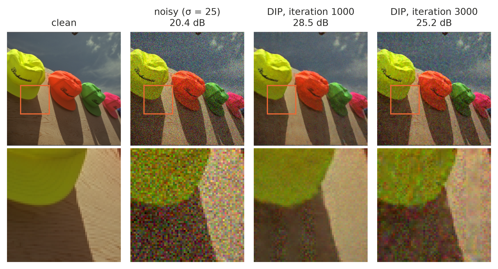
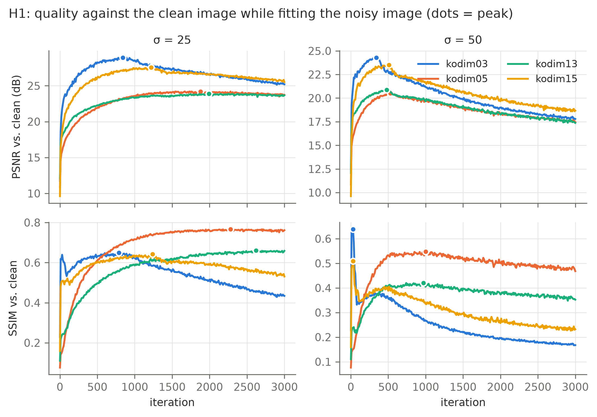
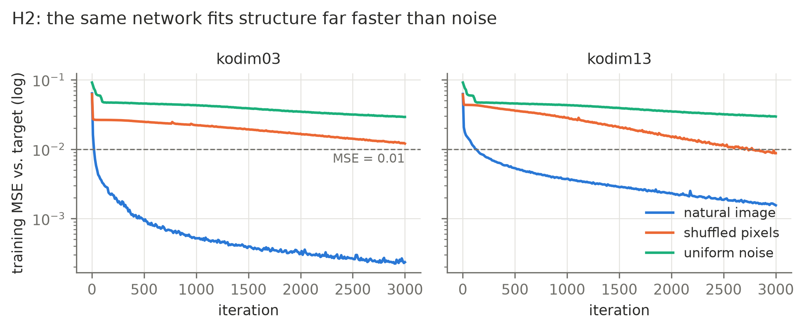
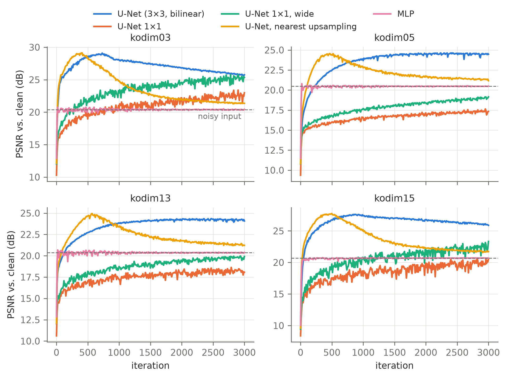
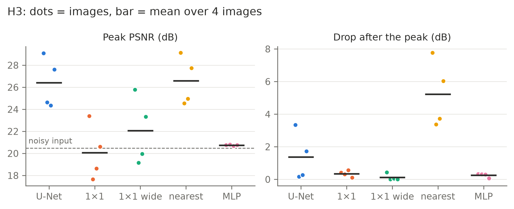
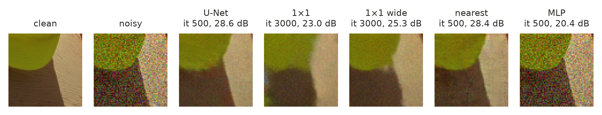
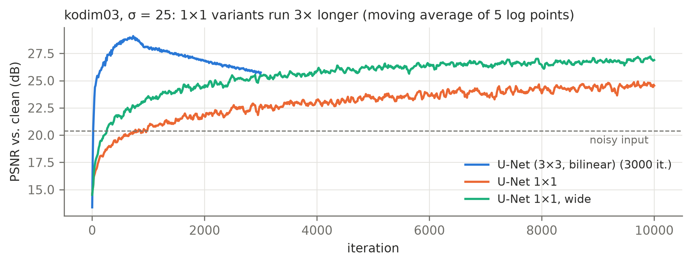
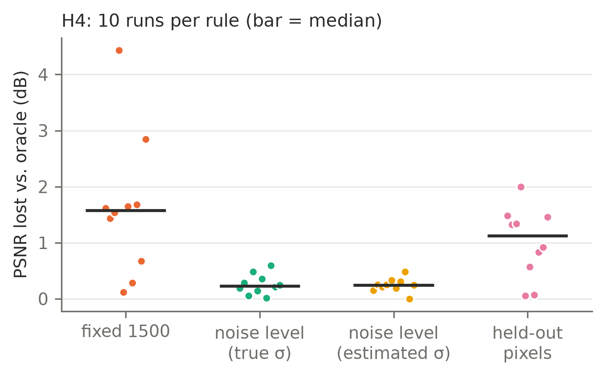
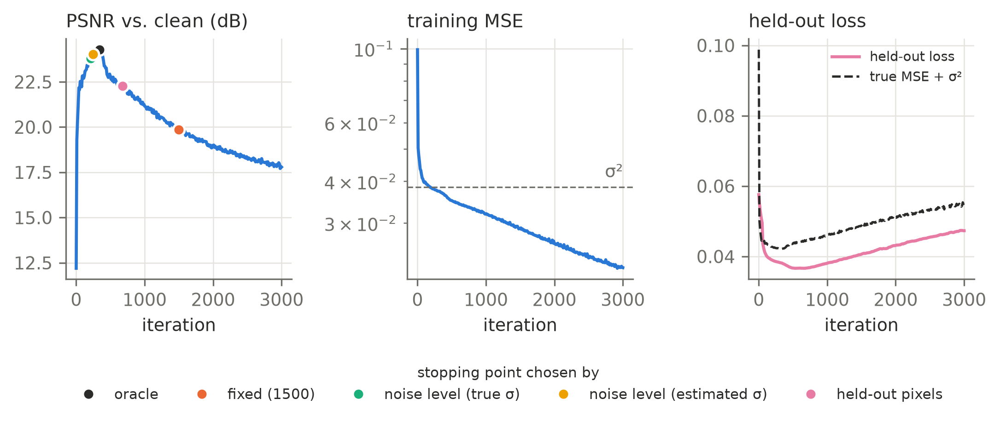
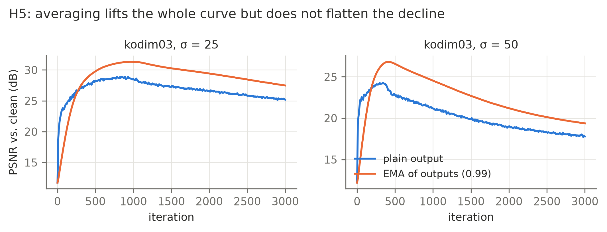

## The plan for the next 60 minutes

| Block | Minutes |
|---|---|
| 1. Motivation: denoising and the surprise of an untrained network | 0–8 |
| 2. Theory: how DIP works, why structure comes before noise | 8–20 |
| 3. Literature: what is already established | 20–27 |
| 4. Our question, hypotheses and setup | 27–32 |
| 5. Results H1–H5 (**reproduced** vs. **new**) | 32–50 |
| 6. Interpretation, alternative explanations, limitations | 50–57 |
| 7. Conclusion and discussion | 57–60 |

::: notes
Introduce the team and who presents which block. Mention that every team member can answer questions on every part.
:::

# 1 · Motivation

## Denoising needs a prior

- We observe a noisy image $y = x + n$ and want the clean image $x$.
- Infinitely many clean images are consistent with $y$, so we need an assumption about **what natural images look like**: a *prior*.
- **Classical priors are hand-designed:** smoothness, sparsity, total variation.
- **Learned priors** come from training on large datasets of clean images.

{width=85% fig-align="center"}

::: notes
The teaser shows the whole story at once: clean, noisy (20.4 dB), DIP at iteration 1000 (28.5 dB) and DIP at iteration 3000 (25.2 dB). The network got better, then worse again. Why?
:::

## The surprise: an untrained network is a prior

> Ulyanov, Vedaldi & Lempitsky (CVPR 2018), *Deep Image Prior*

- Take a **randomly initialised** CNN. **No training data at all.**
- Fit it to **one** noisy image.
- It reproduces the **image** long before it reproduces the **noise**.
- **Stop early, and the output is denoised.**

. . .

**Two questions follow:**

1. Is it really the **convolutional architecture** that makes this happen, and *which part* of it?
2. In practice we don't have the clean image. **How do we know when to stop?**

# 2 · Theory

## Images are numbers, noise is random

- An image is a 256 × 256 × 3 grid of values in $[0, 1]$, i.e. 196,608 numbers.
- **Gaussian noise:** each $n_i$ is drawn from a normal distribution with mean 0 and variance $\sigma^2$, **independently per pixel**.
- We use σ = 25 and 50 on the 0–255 scale, so $\sigma^2 \approx 0.0096$ and $0.038$.
- **Quality metrics:**
  - **PSNR** $= 10 \log_{10}(1/\text{MSE})$ dB: +3 dB ≈ half the error.
  - **SSIM:** similarity of local structure, from 0 to 1 [@wang2004ssim].

::: notes
Independence of the noise is the single most important property. Everything about stopping relies on it.
:::

## Classical denoising vs. DIP

**Classical:** choose a regulariser $R$ by hand
$$\hat{x} = \arg\min_x \; \lVert x - y \rVert^2 + \lambda R(x)$$

**Deep Image Prior:** the network *is* the regulariser
$$\theta^* = \arg\min_\theta \; \lVert f_\theta(z) - y \rVert^2, \qquad \hat{x} = f_{\theta^*}(z)$$

- $z$: a fixed random input that never changes.
- $\theta$: the weights. They are the only thing that is optimised, with Adam.
- **There is no explicit $R$.** The prior is *implicit* in which images the network produces easily.

## The network: a U-Net

| Part | What it does | Size |
|---|---|---|
| **Input** $z$ | fixed random noise | 32 × 256 × 256 |
| **Encoder** (4×) | stride-2 conv + conv: halve the resolution | → 64 × 16 × 16 |
| **Skip connections** | pass 4 channels from each level to the decoder | |
| **Decoder** (4×) | bilinear upsample, concatenate skip, 3×3 conv | → 64 × 256 × 256 |
| **Output** | 1×1 conv + sigmoid | 3 × 256 × 256 |

- **3×3 convolution:** the same small window everywhere (*weight sharing*), mixing **neighbouring** pixels.
- **Bilinear upsampling:** each new pixel is an **average** of its neighbours, which smooths the image.
- **Capacity:** 454k parameters for 196k pixel values, so the network *can* fit the noise eventually.

## Why does structure come before noise?

- **Spectral bias:** gradient descent fits **low frequencies first** [@heckel2020structuralbias].
- **Natural images:** energy concentrated at **low** frequencies (smooth regions, edges).
- **White noise:** energy spread **equally** over all frequencies, so it is mostly high-frequency.

**⇒ The image is fitted fast, the noise slowly. Early stopping exploits this gap.**

. . .

**Which component causes the bias?** The theory points to **upsampling** and **weight sharing**. The Deep Decoder works with only 1×1 convolutions plus upsampling [@heckel2019deepdecoder].

> **Prediction from the literature:** upsampling matters more than kernel size.

## How can we stop without the clean image? (1)

**Discrepancy principle (Morozov)**

- A *perfect* reconstruction $f = x$ would have training loss
$$\tfrac{1}{N}\lVert x - y\rVert^2 = \tfrac{1}{N}\lVert n\rVert^2 \approx \sigma^2$$
- **A loss below σ² means the network is now fitting noise. Stop there.**
- It needs σ, but σ can be **estimated from the noisy image** (wavelet-based estimator).

## How can we stop without the clean image? (2)

**Held-out pixels (self-validation)**

- Hide 10 % of the pixels $M$ from the loss.
- The network never sees $n_M$, and $n_M$ is independent of everything it does see, so:
$$\mathbb{E}\lVert f - y\rVert_M^2 = \lVert f - x\rVert_M^2 \underbrace{- 2\,\mathbb{E}\langle f-x, n\rangle_M}_{=\,0} + |M|\sigma^2$$
- **The measurable held-out loss equals the true error on $M$ plus a constant**, so in theory it has its minimum at the right place.

::: notes
Remember the words "on M". This detail will matter in the results.
:::

## The Bayesian view

- Cheng et al. [-@cheng2019bayesian]: at infinite width, DIP behaves like a **Gaussian-process** prior.
- **Averaging posterior samples** (SGLD) instead of picking one iterate reduces the need for early stopping.
- **Our simplified test:** an exponential moving average of the outputs,
$$\bar{f}_t = 0.99\,\bar{f}_{t-1} + 0.01\,f_t \quad (\approx \text{last 100 outputs})$$

This is *inspired by* Cheng et al., not their method.

# 3 · Literature

## What is established

| Paper | Established result |
|---|---|
| Ulyanov et al. 2018 | An untrained CNN is a strong prior; natural images are fitted faster than noise; early stopping is essential |
| Zhang et al. 2017 | Networks memorise even random labels, just more slowly |
| Heckel & Soltanolkotabi 2020 | Proof: conv generators fit low frequencies first; upsampling is key |
| Heckel & Hand 2019 | 1×1 convolutions + upsampling are already a strong prior |
| Cheng et al. 2019 | DIP ≈ Gaussian process; posterior averaging |
| Wang et al. 2023 | Stopping from the variance of recent outputs |

**Still open:**

- separating **kernels** from **upsampling** within one standard architecture, with capacity controlled;
- comparing **simple stopping rules** against the oracle.

# 4 · Our study

## Hypotheses

| | Hypothesis | Status |
|---|---|---|
| H1 | PSNR rises, peaks, then falls; more so at higher noise | reproduction |
| H2 | A natural image is fitted faster than shuffled pixels or noise | reproduction |
| H3a | 3×3 kernels are necessary | **new** |
| H3b | Bilinear upsampling is necessary | **new** |
| H3c | Without spatial structure (MLP) there is no prior | **new** |
| H4 | We can stop well without the clean image | **new** |
| H5 | EMA makes the stopping point less critical | **new** |

## Setup

- **Data:** 4 Kodak images at 256 × 256; Gaussian noise σ ∈ {25, 50}, added by us so the clean image is known.
- **Model:** simplified DIP U-Net (4 levels, 64 channels), Adam, 3000 iterations, input jitter 1/30.
- **Logged every 10 iterations:** training loss, held-out loss, PSNR and SSIM, for the raw and the EMA output.

**Compute:** 56 runs of about 50 s each on a Colab L4 GPU, plus two 10,000-iteration runs; fully reproducible from the repository.

## H3 · The five architectures

| Model | Kernels | Upsampling | Params |
|---|---|---|---:|
| U-Net | 3×3 | bilinear | 454k |
| U-Net 1×1 | 1×1 | bilinear | 69k |
| U-Net 1×1 wide | 1×1 | bilinear | 454k |
| U-Net nearest | 3×3 | nearest | 454k |
| MLP | — | — | 50.6M |

**Fairness controls:**

- best learning rate per model from a 4-value sweep;
- a parameter-matched 1×1 variant;
- no held-out pixels in H3, since non-spatial models cannot inpaint them.

# 5 · Results

## H1 · PSNR peaks, then falls ✅ (reproduced)

{width=72% fig-align="center"}

- **Drop after the peak:** 1.6 dB at σ = 25 vs. 4.5 dB at σ = 50. Higher noise means an earlier and steeper fall.
- **Textured images** (kodim05, kodim13) peak late: texture behaves like "late" content.
- **Three seeds differ by only 0.1 dB.**

::: notes
SSIM caveat: the short spike at 20 to 40 iterations happens because SSIM rewards the very smooth early output on images with large flat regions. That's why we report PSNR and SSIM side by side.
:::

## H2 · Structure before noise ✅ (reproduced)

{width=80% fig-align="center"}

- **Natural image:** MSE < 0.01 after **20 / 130** iterations.
- **Shuffled pixels:** after 2700 iterations or never. **Uniform noise:** never.
- Same colours, no structure, no speed-up. **The speed comes from spatial structure.**

## H3 · Which component matters? (new)

{width=68% fig-align="center"}

::: notes
Walk through one panel (kodim03). Blue: baseline. Yellow: nearest upsampling, same peak but an earlier and steeper fall. Orange and green: 1×1, which never get good. Pink: MLP, flat at the noisy level.
:::

## H3 · Summary

{width=80% fig-align="center"}

| | Peak PSNR | Drop |
|---|---:|---:|
| U-Net | **26.4** | 1.4 |
| 1×1 / 1×1 wide | 20.1 / 22.1 | 0.4 / 0.1 |
| nearest | **26.6** | **5.2** |
| MLP | 20.8 (≈ noisy) | 0.3 |

## H3 · Verdicts

- **H3a ✅ within 3000 iterations, 3×3 kernels are necessary.** Without them the network gains about 0 dB over the noisy input, and matching the parameters recovers only 2 of the 6 dB lost. (The long runs on the next slide refine this.)
- **H3b ❌ for the peak.** Nearest-neighbour upsampling reaches the **same** peak, but about 3× earlier, and then collapses about **4× faster**.
- **H3c ✅** The MLP has **no prior**: it memorises the noise within a few hundred iterations.

{width=95% fig-align="center"}

## H3 · Weaker prior, or just slower?

{width=80% fig-align="center"}

- **10,000 iterations** for both 1×1 variants (kodim03): still improving at the end.
- **The parameter-matched 1×1 halves its gap** to the U-Net (27.5 vs. 29.1 dB).
- **Its training MSE never reaches σ²;** the U-Net's does after **630** iterations, so structure is fitted **more than 15× more slowly**.
- ⇒ The kernels matter **mainly for speed**. Whether the last 1.6 dB would close is open. This partly contradicts the literature's prediction (upsampling > kernels).

::: notes
This is the honest version of H3a. Within a normal budget the kernels are necessary; in the limit we can't say. Hardware note: the long runs ran on Apple MPS, about 0.3 dB different from CUDA at the same iteration.
:::

## H4 · Stopping without the clean image ✅ (new)

{width=55% fig-align="center"}

| Rule | Mean PSNR lost | Max |
|---|---:|---:|
| Fixed 1500 iterations | 1.63 dB | 4.43 dB |
| Held-out pixels | 1.00 dB | 2.00 dB |
| Noise level, **estimated σ** | **0.24 dB** | 0.48 dB |

## H4 · Why held-out pixels stop too late

{width=90% fig-align="center"}

- The identity holds for the error **on the held-out pixels**.
- But those pixels are never fitted directly: they are only **inpainted from their neighbours**. Noise reaches them **later**.
- So their error keeps falling after the full-image error has turned upward (right panel).

::: notes
This is a nice example of a theoretically sound rule failing because the theory answers a slightly different question than the one we care about.
:::

## H5 · Averaging (EMA) ❌ as stated

{width=80% fig-align="center"}

- The drop after the peak is **not** smaller (3.3 vs. 3.1 dB).
- But the EMA is about **2 dB better everywhere** (peak 27.2 vs. 25.1 dB). Averaging cancels the jitter from the input perturbation, like an ensemble.

# 6 · Interpretation

## What the results mean

- **3×3 kernels make structure fit fast.** That's what makes DIP work within a normal budget.
  - A likely reason the Deep Decoder works without them: it upsamples after *every* layer and has no skips. In our 1×1 U-Net, information can bypass the upsampling through the full-resolution skip path.
- **Bilinear upsampling is a brake on noise.**
  - It doesn't change the best result; it changes **how forgiving** the stopping point is.
  - The spectral-bias theory for upsampling describes the **late phase** in our data.
- **Stopping: the simplest principled rule wins.**
  - The training loss crosses σ² close to the oracle point, and σ is easy to estimate.

## Alternative explanations we checked

| Concern | Check | Outcome |
|---|---|---|
| 1×1 is worse only because it has fewer parameters | parameter-matched variant | still about 4 dB worse |
| A bad learning rate | 4-value sweep per model | the best value was used |
| Held-out pixels unfair to non-spatial models | no held-out pixels in H3 | fixed |
| Single-run noise | 3 seeds | spread of 0.1 dB |
| 1×1 is only slower, not worse | 10,000-iteration runs | partly true: the gap halves, but fitting is >15× slower |
| PSNR-only conclusions | SSIM logged as well | agrees (except the early spike) |

## Limitations

- **Data:** four images, 256 × 256, synthetic Gaussian noise. Real sensor noise is correlated and signal-dependent, which breaks both stopping signals.
- **Seeds:** mostly one seed per run. We only interpret differences well above 0.1 dB.
- **Scope:** one architecture family, with learning rates tuned on one image. "Necessary here" ≠ "sufficient" or "general".
- **Metrics:** PSNR and SSIM only. LPIPS would bring a *learned* prior into a study of priors.
- **EMA ≠ SGLD**, and the stopping rules were not evaluated on the EMA output.

# 7 · Conclusion

## Answers to the research question

**Is the convolutional architecture responsible?** Yes, but its parts do different jobs.

- The **3×3 kernels** make structure fit fast (>15× faster). Without them there is little denoising within a normal budget, even at equal size; with no spatial structure at all (MLP), none.
- **Bilinear upsampling** slows down the fitting of noise, which makes stopping forgiving.

**Can we stop without the clean image?** Yes.

- The discrepancy principle with **estimated σ** comes within **0.25 dB** of the oracle.
- That beats both a fixed budget and held-out pixels.

**Reproduce:** `poetry install` → `scripts/run_all.py` → `scripts/make_figures.py`

## References

::: {#refs}
:::

## Questions?

Thank you!
